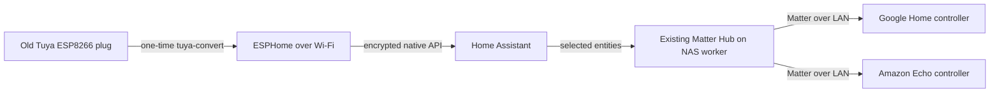

# Tuya plugs to ESPHome

An English-language field guide and reproducible workbench for converting old
Tuya Wi-Fi plugs to ESPHome, then exposing their Home Assistant
entities through an **existing Home Assistant Matter Hub** to Google Home and
Amazon Alexa.

The current batch consists of old, unboxed plugs reported by the owner to use
ESP8266/“ESP-01” hardware. Similar-looking plugs were converted previously.
The first unit reports 1 MB flash and is marked **XS-SSA01**. Its observed button
and LED match the GPIO15-relay variant in the official Tasmota catalog. Identical
markings and similar enclosures can still hide different board revisions.

**First unit physically verified:** the XS-SSA01 profile uses GPIO15 for the relay,
GPIO13 for the button and inverted GPIO12 for the indicator. The operator confirmed
mechanical clicks and actual load switching in both directions. The earlier GPIO12
relay candidate drove only the LED; [the investigation](https://github.com/ha-homelab/ha-tuya-esphome/issues/1)
records that correction. See [the deployment record](docs/deployment-record.md) for
restart and ecosystem acceptance results.

**Second successful conversion:** a WP5 replacement also passed the physical
button/load test with GPIO13 button and GPIO15 relay. The similar Gosund WP5 map
is different; use the [variant identification procedure](docs/gpio.md) before
applying either profile. A separate YM-WS-1 attempt stopped at pairing without
writing firmware.

A later AWP02L-N attempt reached the conversion Wi-Fi but presented patched
Tuya PSK identity version `02`. It never reached the intermediate loader and
received no firmware. Its existing HA and client bindings were retained.
Follow-up research found an experimental ESP8266 CloudCutter port. One experimental
packet was sent to the identified unit in AP mode; its connection dropped, but
replacement-key authentication and conversion remain unverified. See the
[AWP02L-N experimental procedure](docs/awp02l-n-psk02.md).

A second AWP02L-N also failed the ordinary handshake and became unreachable
after its own single experimental packet, before Wi-Fi provisioning or a
replacement-key check. Neither AWP02L-N is counted as converted.

A third AWP02L-N also associated with the expected identity but failed thirteen
PSK `02` handshakes before any firmware transfer. It received no experimental
payload. The session was cleaned up and existing HA/client bindings retained;
the prepared ESPHome image remains uninstalled.

Twenty-one plugs have now received ESPHome relay firmware: two XS-SSA01 units,
five WP5 units, two KMC 30137, three YM-WS-1 units, two JH-G01U units, two
WP3 units, one GREFIC CZ-U201, three KMC 30608 and one Supernight CV01. Fifteen passed their own physical
button/load test; the first two WP5 units also passed their independent
red-indicator check.
Per-unit HA software-restart results are recorded in the deployment record.
For two WP5 units, the second and third YM-WS-1 units, the second JH-G01U and
the second KMC 30137, the operator initially chose the existing model profile
and waived repeated physical and restart tests.
The third converted YM-WS-1 later showed a dim indicator and no response to
its physical button despite a healthy encrypted API. A later probe identified
GPIO1 as its button; GPIO14 relay control and an active-high GPIO13 indicator
then passed the owner's physical lamp/button test. The corrected configuration
preserves its HA identities. See the
[recovery record](docs/deployment-record.md#twelfth-conversion-recovery-alternate-gpio14-profile-confirmed).
Both WP3 units passed encrypted OTA/API, button/load/indicator and software-restart
state checks. The first was also available after relocation; controlled ON-to-OFF mains
power-cycle tests remain pending. Their
[profile and migration notes](docs/wp3-migration.md) keep those results separate.
The latest WP5 passed its own button/load/indicator test, encrypted API control
and a software restart to reported OFF. This unit omits the separate
red-indicator channel and was available after relocation; a controlled mains-cycle
test was not performed.
The [GREFIC CZ-U201](docs/grefic-cz-u201.md) has two independently controlled
relay channels identified from its original application. Both outlets, the shared
button and a controlled mains cycle passed physical acceptance.
The [KMC 30608 Smart Tap](docs/kmc-30608.md) passed separate lamp checks on all
three numbered outlets, common-button control and a controlled mains cycle.
Its existing three HA entity IDs now use ESPHome. Voltage, current, power and
energy metering are enabled. All three KMC units have individual voltage
reference corrections; current, power and energy remain uncalibrated.
The second KMC also passed outlet, button and mains-cycle acceptance and its HA
handover. Its stock table shows that Tuya datapoint numbers and physical outlet
numbers differ; both KMC handovers now retain that association. The second
sample's separate outlet indicators remain unresolved; further diagnosis was
deferred by the owner.
A third KMC, running stock firmware 1.0.6 with 1 MiB DOUT flash, also accepted
ordinary Tuya-Convert. Its GPIO16 button, independent native relay controls and
software restart to all OFF passed. The owner confirmed a load on physical
outlet 1, then deferred the remaining physical and HA service switching tests.
All outputs were returned OFF. HA exposes its three switches and four measurements;
its source and private credentials are saved in HA and ESPHome Dashboard.
The [Supernight CV01](docs/supernight-cv01.md) passed independent outlet/button
checks and a controlled mains cycle, and now exposes two switches and four
uncalibrated measurements in HA.
The first two converted plugs passed actual load switching from Google Home and
Amazon Alexa through the existing Matter Hub.
The operator deferred later controller checks. The original controller fabrics
were preserved when Alexa was added. See the deployment record for migration
results and remaining checks.

The later YM-WS-1 reached the ordinary conversion loader and now runs ESPHome.
Its GPIO15 relay, GPIO13 button and inverted GPIO12 indicator passed the
operator's load test. This success is recorded separately from the earlier
unflashed pairing attempt; the marking alone still does not select a variant.

The JH-G01U uses GPIO4 for its verified relay and GPIO5 for its verified button.
Its GPIO12 indicator initially ran opposite to the load. Active-low polarity was
then installed through encrypted OTA and the API checked again; the corrected
indicator has not yet been visually rechecked. See [GPIO details](docs/gpio.md).

ESPHome does not turn an ESP8266 plug into a native Matter device. Matter Hub
provides that bridge. Home Assistant's separate **Matter Server** manages Matter
devices for Home Assistant; it is not the component exporting arbitrary ESPHome
entities.

## Start here

1. [Understand the hardware and batch policy](docs/hardware.md).
2. [Prepare the Linux workbench](docs/workbench.md).
3. [Build and convert one plug](docs/conversion.md).
4. [Identify its GPIOs and finish the ESPHome configuration](docs/gpio.md).
5. [Expose selected entities to Google Home and Alexa](docs/matter.md).
6. Use [troubleshooting](docs/troubleshooting.md) and record progress in the
   [task list](ROADMAP.md).

A separate TECKIN SP20 was migrated from Tasmota to ESPHome with its metering
calibration and cumulative counters carried across. This maintenance migration
is separate from the twenty-one Tuya firmware conversions. For an already converted plug,
use the [metered SP20 procedure](docs/tasmota-sp20-migration.md).

## Project policy

- Convert one disconnected-load plug at a time.
- Do not initialize this batch in Tuya/Smart Life or install vendor updates first.
- The original batch policy skips factory-firmware backups and accepts retiring
  unsuccessful units rather than spending time on serial recovery. Its container
  disables the upstream download step; session logs and metadata are still local.
  The later [WP3 attempt](docs/wp3-migration.md) and a subsequent WP5 saved stock
  backups as per-unit exceptions. The GREFIC investigation also retained a private
  post-loader flash image to recover its hardware configuration. Any backup remains private and is never
  published here.
- Start unidentified variants with a GPIO-neutral ESPHome image. Record an
  operator's explicit choice to reuse a same-model profile without repeated tests.
  A working Wi-Fi/API connection and a functional mains relay are different milestones.
- Keep Wi-Fi settings, API keys, actual addresses, device identifiers, logs,
  compiled firmware and Matter commissioning data out of this repository.

## What is included

- A pinned `tuya-convert` source revision and Python 3.11 container recipe.
- A TLS-PSK compatibility patch and executable binary-identity handshake check.
- An isolated-radio launcher that preserves the Ethernet management connection.
- A minimal ESPHome 2026.9.1 configuration targeting `esp01_1m`.
- Local secret generation, binary size validation, and operating procedures.
- A metered Tasmota migration example with persistent energy-counter tests.
- An anonymized [deployment record](docs/deployment-record.md).

Repository provisioning is managed by
[terraform-github-ha-homelab](https://github.com/4alvit/terraform-github-ha-homelab).
See [CONTRIBUTING.md](CONTRIBUTING.md) and [SECURITY.md](SECURITY.md).

## Upstream projects

[Tuya-Convert](https://github.com/ct-Open-Source/tuya-convert),
[ESPHome](https://esphome.io/),
[Home Assistant](https://www.home-assistant.io/), and
[RiDDiX Home Assistant Matter Hub](https://github.com/RiDDiX/home-assistant-matter-hub)
provide the underlying tools. This repository is an independent integration
project and does not claim that every Tuya firmware or plug is compatible.
