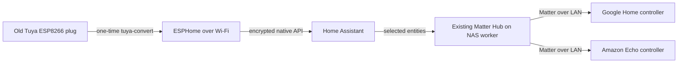

# Tuya plugs to ESPHome

An English-language field guide and reproducible workbench for converting old,
uncommissioned Tuya Wi-Fi plugs to ESPHome, then exposing their Home Assistant
entities through an **existing Home Assistant Matter Hub** to Google Home and
Amazon Alexa.

The current batch consists of old, unboxed plugs reported by the owner to use
ESP8266/“ESP-01” hardware. Similar-looking plugs were converted previously.
The first unit reports 1 MB flash and is marked **XS-SSA01**. Its observed button
and LED match the GPIO15-relay variant in the official Tasmota catalog. Identical
markings and similar enclosures can still hide different board revisions.

**First unit physically verified:** the XS-SSA01 profile uses GPIO15 for the relay,
GPIO13 for the button and inverted GPIO12 for the indicator. The operator confirmed
mechanical clicks and actual load switching in both directions. The earlier GPIO12
relay candidate drove only the LED; [the investigation](https://github.com/ha-homelab/ha-tuya-esphome/issues/1)
records that correction. See [the deployment record](docs/deployment-record.md) for
restart and ecosystem acceptance results.

**Second successful conversion:** a WP5 replacement also passed the physical
button/load test with GPIO13 button and GPIO15 relay. The similar Gosund WP5 map
is different; use the [variant identification procedure](docs/gpio.md) before
applying either profile. A separate YM-WS-1 attempt stopped at pairing without
writing firmware.

ESPHome does not turn an ESP8266 plug into a native Matter device. Matter Hub
provides that bridge. Home Assistant's separate **Matter Server** manages Matter
devices for Home Assistant; it is not the component exporting arbitrary ESPHome
entities.

## Start here

1. [Understand the hardware and batch policy](docs/hardware.md).
2. [Prepare the Linux workbench](docs/workbench.md).
3. [Build and convert one plug](docs/conversion.md).
4. [Identify its GPIOs and finish the ESPHome configuration](docs/gpio.md).
5. [Expose selected entities to Google Home and Alexa](docs/matter.md).
6. Use [troubleshooting](docs/troubleshooting.md) and record progress in the
   [task list](ROADMAP.md).

## Project policy

- Convert one disconnected-load plug at a time.
- Do not initialize this batch in Tuya/Smart Life or install vendor updates first.
- The owner explicitly chose **no factory-firmware backups** and accepts retiring
  unsuccessful units rather than spending time on serial recovery. The container
  disables the upstream download step; session logs and metadata are still local.
- Start with a GPIO-neutral ESPHome image. A working Wi-Fi/API connection and a
  functional mains relay are different milestones.
- Keep Wi-Fi settings, API keys, actual addresses, device identifiers, logs,
  compiled firmware and Matter commissioning data out of this repository.

## What is included

- A pinned `tuya-convert` source revision and Python 3.11 container recipe.
- A TLS-PSK compatibility patch and executable binary-identity handshake check.
- An isolated-radio launcher that preserves the Ethernet management connection.
- A minimal ESPHome 2026.9.1 configuration targeting `esp01_1m`.
- Local secret generation, binary size validation, and operating procedures.
- An anonymized [deployment record](docs/deployment-record.md).

Repository provisioning is managed by
[terraform-github-ha-homelab](https://github.com/4alvit/terraform-github-ha-homelab).
See [CONTRIBUTING.md](CONTRIBUTING.md) and [SECURITY.md](SECURITY.md).

## Upstream projects

[Tuya-Convert](https://github.com/ct-Open-Source/tuya-convert),
[ESPHome](https://esphome.io/),
[Home Assistant](https://www.home-assistant.io/), and
[RiDDiX Home Assistant Matter Hub](https://github.com/RiDDiX/home-assistant-matter-hub)
provide the underlying tools. This repository is an independent integration
project and does not claim that every Tuya firmware or plug is compatible.
