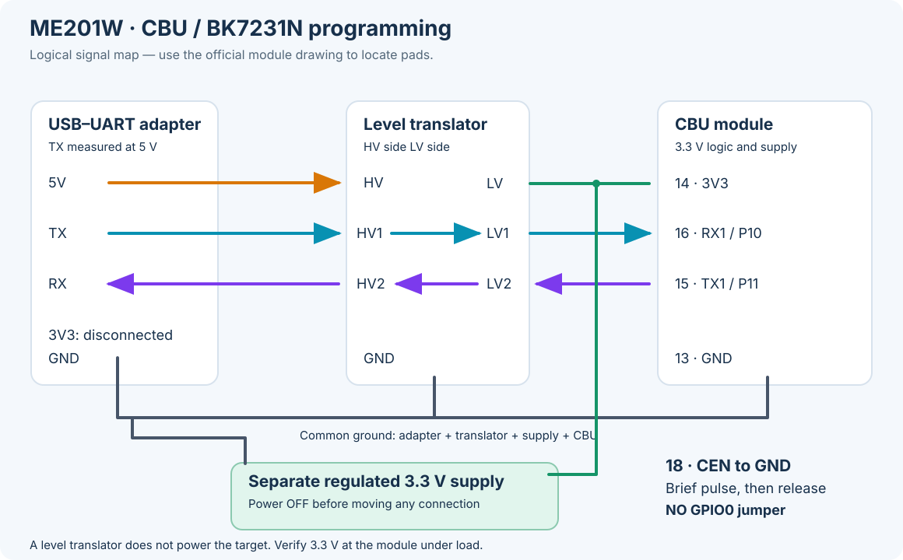

# ME201W / CBU: preparation for wired conversion

[Русский](me201w-cbu-preparation.ru.md) · [Workbench](workbench.md)

**Status on 2026-10-23: preparation only.** No ME201W flash read, firmware write,
or ESPHome measurement has been verified in this project. The label in the
owner's photograph identifies **CBU**, which uses **BK7231N**; this is a different
platform from the earlier TYWE3S / ESP8266 switches.

The older sensor responds on Wi-Fi and advertises Tuya protocol 3.4, while its
Home Assistant reading remains unavailable. The second sensor did not respond
in the network check. Both have a reported history of water ingress. Network
reachability does not establish that the measurement board is working.

The owner suspects the flooded measurement assembly may require replacement.
Treat it as unvalidated hardware, not as a confirmed software fault. Keep radio
recovery separate from sensor acceptance. A replacement assembly must have its
power requirements and interface verified; similar connectors do not establish
electrical or protocol compatibility.

## Connection plan



This is a **signal diagram, not a pad-position drawing**. Identify the numbered
module pads from the [official CBU drawing and pin definitions][cbu] before
placing probes. Do not count the carrier connector's contacts or reuse the
TYWE3S photograph's left/right instructions.

- **13 / GND:** common ground with the supply, adapter and translator.
- **14 / 3V3:** regulated external 3.3 V supply; also supplies translator LV.
- **16 / RX1 / P10:** receives adapter TX through HV1 → LV1.
- **15 / TX1 / P11:** sends to adapter RX through LV2 → HV2.
- **18 / CEN:** momentarily connect to GND, then release when the tool is waiting
  for the bootloader. Do not keep CEN grounded during transfer.

For the previously measured **5 V TX adapter**, power translator HV from adapter
5 V. Keep its 3V3 output disconnected from the external 3.3 V rail. Use the same
channel number on the two sides of each signal. The translator converts logic
levels; it does **not** supply the target's power. A genuine 3.3 V logic adapter
can use direct UART wiring after its output level is checked.

Use five firmly held probes for the five CBU connections. An extra probe is
useful for monitoring the supply. Connect with power off, use an insulated
fixture, and make sure a tip cannot bridge adjacent pads. The module expects
3.0–3.6 V, nominally 3.3 V; provide a stable source with headroom for startup
current. Check voltage **at the module under load**, not just at the supply.

Disconnect the sensor's normal power source before applying external module
power. The carrier's normal input voltage is not permission to apply that
voltage to CBU. Inspect and dry water-damaged boards first. If the carrier MCU
shares UART1, identify how to isolate its UART before connecting two transmitters
to the same wire; do not guess connector functions.

**No GPIO0 jumper is used for this CBU procedure.** Use `ltchiptool`, not
`esptool`. The [LibreTiny Beken guide][beken] distinguishes UART1 for flashing
from UART2 for boot logs; silence on UART1 in a text terminal is not a failed
bootloader test.

## Workbench sequence

1. Inventory the USB adapter and check whether another process owns its serial
   port. Preparation must not open or reset the attached target. Use a persistent
   `/dev/serial/by-id/…` path when available.
2. Keep the Beken tool environment separate from the existing ESP8266 workbench.
   Record the installed versions and retain CLI help with the private session
   notes. No conversion access point or phone connection is needed for UART.
3. After the physical wiring check, use the [read-flash workflow][ltchiptool]
   with family `BK7231N`. Read the complete **2,097,152 bytes from offset zero**
   twice, into two different files. Compare their lengths and SHA-256 hashes.
   Keep the target out of its normal application between reads, so application
   writes cannot change the comparison.
4. Stop if either read is incomplete or the copies differ. Keep raw dumps,
   credentials and logs private, and copy the verified backup to a second host
   before changing firmware. This sensor procedure requires a backup even though
   the original plug batch used a different policy.
5. Inspect the backup and identify the measurement interface. Validate and build
   a `bk72xx: { board: cbu }` configuration. The first diagnostic image must not
   drive unverified GPIOs or invent level readings. Build success is not hardware
   acceptance.
6. Only after backup verification and selection of the correct image, use the
   generated **UF2** with automatic format detection. Do not force an arbitrary
   raw binary to offset zero. Record the image hash and tool result privately.
7. Remove programming connections with power off, restore the intended power
   arrangement, and verify boot, API availability and actual measurements.

The [CBU recovery example](../examples/me201w-cbu-recovery.yaml) provides Wi-Fi
and encrypted ESPHome API/OTA only, with serial logging disabled and no UART,
Tuya MCU or application GPIO configuration. It is a recovery starting point,
not a working ME201W sensor profile. The selected compiler is ESPHome 2026.9.1;
device installation and sensor acceptance remain pending.

Offline preparation passed on 2026-10-23: configuration validation and compilation
with ESPHome 2026.9.1 / LibreTiny 1.13.0 succeeded, and `ltchiptool flash file`
recognized a valid BK7231N UF2. The build reported 46,196 / 262,144 bytes RAM
(17.6%) and 582,950 / 1,083,136 bytes flash (53.8%). Private copies on two hosts
had matching SHA-256 hashes. These checks validate the build artifact, not the
sensor hardware or its measurements.

Disabled application serial logging is not a guarantee of electrically idle
UART pins: ROM, bootloader or framework startup can still produce activity.
Isolate a competing transmitter before connecting the programming adapter.

## Reproducible host tools

The prepared Linux host uses **ltchiptool 4.15.0**, **bk7231tools 2.1.2**,
**TinyTuya 1.20.0** and **pyserial 3.5**, isolated from the legacy ESP8266 tools.
The pinned direct dependencies are in [requirements-cbu.txt](../requirements-cbu.txt).
Python 3.11 works for these tools. ESPHome 2026.9.1 requires newer Python;
use its pinned container for compilation instead of modifying the system Python.
The Linux `fuser` utility (usually package `psmisc`) is required for port checks.

From the repository checkout, prepare a private directory **outside the checkout**:

```sh
workbench="$HOME/.local/share/cbu-workbench"
mkdir -p "$workbench"
chmod 700 "$workbench"
python3 -m venv "$workbench/venv"
"$workbench/venv/bin/pip" install -r requirements-cbu.txt
python3 scripts/cbu_workbench.py --workdir "$workbench" preflight
```

`preflight` only inventories devices, port owners and free space. It does not
open a serial port. The following also performs **no hardware access**:

```sh
python3 scripts/cbu_workbench.py --workdir "$workbench" backup \
  --port /dev/serial/by-id/REPLACE_WITH_ACTUAL_ADAPTER --dry-run
```

After the wiring and power checks, first identify the attached chip and confirm
its reported flash capacity is **2 MiB** (this command accesses the hardware):

```sh
"$workbench/venv/bin/python" -m ltchiptool flash info bk7231n \
  -d /dev/serial/by-id/REPLACE_WITH_ACTUAL_ADAPTER -b 115200 -t 30
```

If the chip or capacity differs, stop and revise the procedure. The backup helper
uses a fixed CBU length. After identity verification, the operator can remove
`--dry-run` from the backup command to run two full reads. Each connection has a 30-second link timeout and each complete
read has a 15-minute process limit. The script never issues a flash erase or
write. It refuses a busy port, incomplete or uniformly blank dump, and unequal
copies; only matching complete reads produce a success receipt. Dumps, logs
and receipts use private permissions in timestamped directories. Copy the
verified backup to another private host before writing any firmware.

The ownership check and work-directory lock prevent known competing readers;
they are not a kernel-exclusive serial lock. Keep terminal monitors and other
flashing tools closed throughout both reads.

Prepare the recovery source separately with unique private credentials:

```sh
mkdir -p "$workbench/firmware"
cp examples/me201w-cbu-recovery.yaml "$workbench/firmware/"
python3 scripts/create-secrets.py "$workbench/firmware/secrets.yaml"
docker run --rm -v "$workbench/firmware:/config" \
  ghcr.io/esphome/esphome:2026.9.1 config me201w-cbu-recovery.yaml
docker run --rm -v "$workbench/firmware:/config" \
  ghcr.io/esphome/esphome:2026.9.1 compile me201w-cbu-recovery.yaml
```

These container commands validate and build only; no USB devices are passed
through. Keep their output private because configuration output can contain
credentials. Do not use the ESP8266 raw-binary staging script for the resulting
CBU UF2. Inspect the file with `ltchiptool flash file` before any later write.

## Measurement and Home Assistant handover

The photograph shows a separate measurement PCB. A Tuya MCU UART link is a
candidate, **not yet confirmed for this revision**. The upstream
[ME201W tuya-local profile][profile] is a useful comparison: it maps DP2 to depth
in metres with a scale of 100 and DP22 to percent; several configuration values
are optional. A Tuya LAN datapoint profile does not prove the internal UART
protocol, baud rate, GPIO wiring, or post-conversion behavior.

Capture the actual interface before configuring [ESPHome Tuya MCU][tuya]. Check
known distances at multiple positions, scaling and direction, invalid/no-echo
values, update interval, disconnection and a power cycle. A reconnecting API
must not turn an old sample into an apparently fresh water-level measurement.

Adopt the converted sensor under a temporary identity first. Preserve the
existing `water_cm` source and pump automations until those checks pass and the
intended replacement is confirmed. Do not delete LocalTuya entries, move pump
thresholds, or infer a water level of zero from an unavailable sensor as part of
workbench preparation.

## Troubleshooting

- **No bootloader response:** check the selected port and its owner, common
  ground, TX/RX direction, translator channel pairing, CEN release and loaded
  supply voltage. Check for a competing carrier MCU before repeating resets.
- **Unstable reads or different hashes:** inspect probe contact and power first.
  Do not proceed to an erase or write to troubleshoot a bad read.
- **Wi-Fi works but no level:** diagnose the measurement board and actual UART
  protocol. Reflashing the Wi-Fi module cannot repair water-damaged electronics.
- **Serial transfer works only slowly:** use a lower supported transfer rate and
  short leads; retain full readback verification. A successful short handshake
  alone is insufficient.

[cbu]: https://developer.tuya.com/en/docs/iot/cbu-module-datasheet?id=Ka07pykl5dk4u
[beken]: https://docs.libretiny.eu/docs/platform/beken-72xx/
[ltchiptool]: https://docs.libretiny.eu/docs/flashing/tools/ltchiptool/
[profile]: https://github.com/make-all/tuya-local/blob/main/custom_components/tuya_local/devices/me201w_level_sensor.yaml
[tuya]: https://esphome.io/components/tuya/
