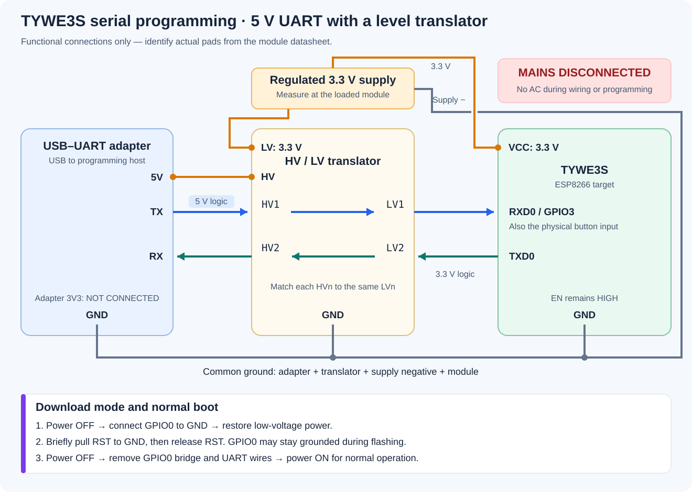

# SWP1-PW2-V5 / TYWE3S: verified serial conversion

[Русский](swp1-pw2-v5.ru.md) · [Standalone ESPHome profile](../examples/swp1-pw2-v5.yaml)

One SWP1-PW2-V5 sample was converted on 2026-10-18 after ordinary Tuya-Convert
failed with PSK identity `02`. A wired probe identified an ESP8266EX, a 26 MHz
crystal and 2 MiB flash. A verified factory backup supplied the GPIO map before
the final firmware was written. The owner subsequently confirmed normal
installed operation as a bookshelf outlet.

This is evidence for this sample, not every product with a similar enclosure.
The old, burned switch used as a hardware reference was a different device:
its Home Assistant identity and LocalTuya configuration were preserved.

## Confirmed hardware

- Relay: **GPIO13, active high**, with `ALWAYS_OFF` restoration.
- Physical button: **GPIO3 / RXD0, active low**, pull-up and 30 ms debounce.
- Relay indicator: **GPIO14, active low**, follows commanded relay state.
- Connection-status indicator: **GPIO0, active low**.
- Serial logging: disabled; disconnect the programmer's UART wires before
  testing the button, because its input shares RXD0.

The factory application's hardware JSON identified these assignments; later
button/relay/indicator observations agreed with them. No GPIO output sweep or
neutral diagnostic firmware was needed. The profile configures no electrical
metering. An LED or API state is not feedback from the relay contacts.

## Low-voltage wiring

**Disconnect the device completely from mains before opening or connecting
anything. Keep it disconnected throughout programming.** Use a regulated 3.3 V
source and verified 3.3 V UART logic. A translator changes signal levels; it
does not supply regulated power to the target.



The drawing shows electrical connections, **not physical pad positions**.
Locate module pins using the [Tuya TYWE3S datasheet](https://developer.tuya.com/en/docs/iot/wifie3smodule?id=K9605ua1cx9tv),
checking its drawing orientation against your board. Do not infer a carrier
test pad from its position. The documented nominal supply is 3.3 V.

For the 5 V-logic adapter used in this case:

1. Adapter **5V → HV** reference of the level translator.
2. External regulated **3.3V → module VCC and translator LV**.
3. Adapter GND, translator GND, supply negative and module GND share one ground.
4. Adapter **TX → HV1**, matching **LV1 → module RXD0**.
5. Module **TXD0 → LV2**, matching **HV2 → adapter RX**.
6. Leave the adapter's 3V3 output disconnected. Do not parallel two supply outputs.

Use a translator suitable for the UART speed and direction. This particular
chain worked at 115200 baud after the wiring was corrected; that does not
qualify every inexpensive HV/LV board. A genuine 3.3 V UART adapter can omit
the translator after its output level is verified.

The adapter initially read 3.3 V unloaded, but the connected target received
only **1.9 V**. It also drove its TX signal to **5.1 V**. Those are separate
problems: an external supply fixed target power, and the translator handled
UART levels. Measure VCC at the loaded module and signal levels against the
same ground. See [ESPHome's physical connection guidance](https://esphome.io/guides/physical_device_connection/).

## Download mode, backup and firmware

With power off, hold **GPIO0 to GND**. Restore low-voltage power, then briefly
connect **RST to GND and release RST**. Keep EN high; do not hold RST low.
GPIO0 may remain grounded during flashing, but remove that bridge before a
normal boot. The readable ROM message `boot mode:(1,0)` confirmed download
mode in this case. See [Espressif's boot-mode documentation](https://docs.espressif.com/projects/esptool/en/latest/esp8266/advanced-topics/boot-mode-selection.html).

Only one program may own the serial port. Exit Miniterm before running
esptool. Correct crossed TX/RX connections resolved the final communication
failure; a lit LED had not established a working serial link.

Before writing, the operator read **all 2,097,152 bytes** of factory flash and
verified that backup against the device with esptool. Keep backups, raw serial
logs, compiled images and credentials outside public Git: a factory dump can
contain provisioning secrets. The [esptool command reference](https://docs.espressif.com/projects/esptool/en/latest/esp8266/esptool/basic-commands.html)
documents identification, `read-flash`, `verify-flash` and `write-flash`.
Choose the read size from the actual flash probe, not the enclosure name.

Build the [standalone profile](../examples/swp1-pw2-v5.yaml) in a new private
directory. Run these commands from the repository root; copy only this profile,
not the generic base or an XS-SSA01 package:

```sh
SWP_REPO="$PWD"
SWP_BUILD_DIR="$HOME/.local/share/esphome/swp1-private"
umask 077
mkdir -p "$SWP_BUILD_DIR"
cp "$SWP_REPO/examples/swp1-pw2-v5.yaml" "$SWP_BUILD_DIR/"
python3.12 -m venv "$SWP_BUILD_DIR/.venv"
"$SWP_BUILD_DIR/.venv/bin/python" -m pip install 'esphome==2026.9.1'
"$SWP_BUILD_DIR/.venv/bin/python" "$SWP_REPO/scripts/create-secrets.py" \
  "$SWP_BUILD_DIR/secrets.yaml"
"$SWP_BUILD_DIR/.venv/bin/python" -m esphome compile \
  "$SWP_BUILD_DIR/swp1-pw2-v5.yaml"
```

The secrets helper prompts for Wi-Fi credentials and generates distinct keys;
it refuses to overwrite existing secrets. These commands compile without
flashing. See the [encrypted provisioning notes](security-profile.md) for
credential handling. This sample used
**ESPHome 2026.9.1**, `esp_wroom_02`, **2 MiB, DOUT, 40 MHz**. Its installed
image was **429,600 bytes**, written at address `0x0` at 115200 baud; esptool
confirmed the written hash. Rebuilds can differ in size, so this byte count is
an observation rather than an installation requirement.

## Normal boot and acceptance

Power down, remove GPIO0–GND and both UART signal wires, then restore only
external 3.3 V. The encrypted native API connected; ON/OFF controls worked,
and a software restart from ON returned the relay state to OFF. The owner
confirmed two button presses with relay clicks and the indicator following.

Next, all temporary wiring and external power were removed and the enclosure
was assembled before normal installation. The owner reported that it worked
at the installed outlet. **A controlled mains-cycle test from ON, contact
voltage measurements and boot-transient measurements were not performed.**
Bench relay clicks alone would not have proved load switching.

Home Assistant received one relay plus connection, signal, version and restart
diagnostics. The installed role was renamed in HA without reflashing the
device: its original firmware hostname remains valid. Complete private source
was saved in both HA's ESPHome directory and ESPHome Dashboard. The relay was
added once to the second dashboard page's Living Room section. A future source
deployment must preserve those registry identities or explicitly migrate them.

## If a step fails

- **No serial reply:** check loaded VCC, common ground, adapter TX → module RX,
  module TX → adapter RX, and that no terminal holds the port.
- **Unreadable bytes:** capture a fresh reset at 74880 baud for the ROM log;
  use the selected esptool baud rate for the actual transfer.
- **Still in download mode:** remove the GPIO0 ground bridge and restart.
- **Status LED stays lit during reset:** GPIO0 also drives that LED here;
  a grounded boot strap can explain it. Do not use this as a reset test.
- **Button fails with programmer connected:** disconnect UART; GPIO3 is shared.
- **API works but load does not:** a reported relay state does not diagnose
  contacts, coil power or mains wiring. Do not probe an exposed live board.
